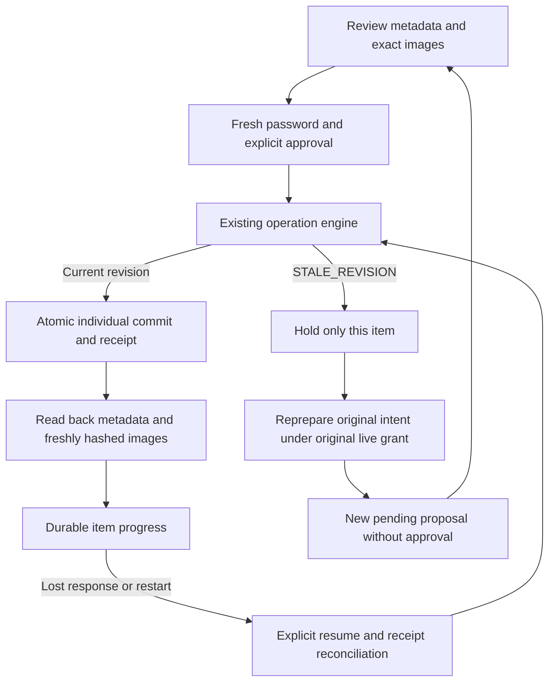

# One-click Approve & Finish — isolated implementation

Date: 2026-11-08. Base: `15e78646aa62afb86ac8a6e7d5aa9b43e46bb5ee`.
Status: development implementation; production HOLD. No production data or deployment changes.

## Implemented contract

`MCP_V2_FINISH_ENABLED=1` opts into development only, with MCP v2 enabled.
Production configuration rejects the flag. Default is OFF. The ordinary
approval-only and MCP bearer tool contracts remain available and unchanged.

An authenticated seller opens the existing operation review URL. The opted-in
page shows an initially unchecked metadata acknowledgment alongside the existing
exact-image review controls. After review and fresh password entry,
**Approve & Finish** requests approval, then invokes the existing operation
engine, reads back metadata and freshly hashed physical image roles, and records
progress. An `active:true` catalog proposal publishes through the existing
catalog service as part of its approved commit. There is no external marketplace
publishing and no Shopee API call.

The service processes prepared catalog CREATE/UPDATE and staged upload/layout
operations. It does not take arbitrary tool names, SQL, URLs, scope selectors,
seller identities, replacement content or approval flags from an orchestration
request. Product bytes still pass through the native codec before review.

### Batch

`/oauth/operation?operationIds=<uuid>,<uuid>` accepts one to five distinct IDs in
the isolated feature. The seller reviews each complete proposal and every unique
exact image for that proposal, advances with an explicit acknowledgment, then
enters their password once and clicks Approve & Finish. Each existing approval
handler independently verifies that password and its full challenge/evidence
outside its writer lock. Five is the bounded batch limit, consistent with the
existing address approval limit. Jobs require one original client and grant.
The earliest proposal expiry also fences the browser's entire batch.

The batch is a sequence of individual atomic commits, not an all-or-nothing
bulk transaction. Earlier successes remain committed when another item fails.
Progress reports `FINISHED`, `PARTIAL` or `IN_PROGRESS`, with each item's receipt,
operation state and fixed error code. A successful verification is recorded once.

### First-party execution authority

The browser does not receive, save or manufacture an OAuth bearer token.
The new trusted engine entry points authenticate the seller session and CSRF,
require the operation's original live OAuth grant, current account capability,
original explicit consent, tenant, epoch and build, and recheck these at commit.
Execution additionally requires the original approval's exact seller session.
The operation engine still validates fresh approval expiry, stored preview hash,
all PAGE/ASSET evidence, current revision, native-stage integrity, CAS and audit.
Public bearer verification continues through the original unchanged verifier.

Job rows and successful progress markers confer no authority. A resumed write
passes the full operation engine again. A repeated committed operation returns
its existing receipt and cannot duplicate products, stock movements or uploads.
Only job IDs are stored in sessionStorage; passwords and challenges are not
persisted by this feature. Challenges remain in page memory only. The server
never persists the submitted password in job data, progress events or receipts.

### APIs (same origin, seller cookie; mutations also require CSRF)

- `POST /api/v1/seller/mcp/finishes`: `{items:[{operationId,previewHash}],idempotencyKey}`.
- `GET /api/v1/seller/mcp/finishes/:jobId`: bounded progress and minimal receipts.
- `POST .../:jobId/approve`: `{items:[{operationId,previewHash,challenge,mediaReviewed:true}],password}`.
- `POST .../:jobId/resume`: `{}`. Never grants missing approval.
- `POST .../:jobId/revalidate`: `{operationId,idempotencyKey}`. Catalog intents only.

Prepare idempotency binds the ordered operation IDs/hashes and original client,
account, tenant and session. Changed requests conflict. Revalidation stores an
idempotent source/replacement mapping. Jobs survive application reconstruction;
no background daemon or cron is installed. Execution proceeds in the backend
request; another browser request can poll progress. A lost request or restart is
reconciled by explicit Resume, using the operation receipt as authority for what
committed. No password is needed to resume an approval that is still genuinely
fresh and valid. Expired approval requires a new review and fresh password.

### State and approval flow

### STALE_REVISION

CREATE currently hashes whole-catalog metadata. Committing one previously
prepared CREATE can stale another independent CREATE. This is security
invalidation, not permission to rewrite an approved envelope.

The job stops that item with `STALE_REVISION`. Revalidate re-runs the original
normalized intent through the existing engine/native path under the original
grant, stores a NEW proposal, links old and new operation IDs in progress audit,
and requires complete fresh review, image acknowledgments and password approval.
It never transfers old approval or mutates an old preview hash. This version
conservatively requests renewed approval for every stale revision; it does not
claim a proven content-equivalence rebase. Media-stage revalidation returns a
restaging requirement instead of attempting to revive consumed/expired bytes.

The user-reported SPL2 COMMITTED / Petal Nut M5 and SPL3 STALE_REVISION case is
historical input. It was reproduced using fictional local products. Those live
operations/products have not been queried, changed, reapproved or recommitted.

## Storage and release boundary

An explicit feature opt-in initializes an independently versioned development
extension (`seller_mcp_finish*`) on SQLite and PostgreSQL. It does not change base
schema 34, the existing operation storage fingerprint or production migration
paths. Extension metadata checks its source DDL identity; production adoption
requires a reviewed migration and actual schema-manifest validation. Jobs are
bound to tenant revision, original grant, account, session, epoch and build.
There is a 1,000-job cap per seller; a production retention/cleanup policy is not
implemented. Existing operation redaction and receipt retention continue; jobs
do not preserve private proposal content beyond those policies. Operation-linked progress,
revalidation mappings and progress events cascade at existing operation receipt
removal, so development jobs cannot pin expired operation receipts indefinitely.

## GO / HOLD

**HOLD for the complete requested feature and production.** The isolated
prepared-operation flow is implemented; the following acceptance work remains:

1. One immutable parent plan combining a new product, all not-yet-staged images,
   final gallery order and publication. Existing upload stages require an
   already-created product. Consequently a new product followed by new uploads
   still requires separate proposals/reviews today. Do not create placeholder
   live products or auto-approve derived children to hide this gap.
2. A content-equivalence proof over all metadata, prices, stock, options, sibling
   effects, exact image bytes/roles and publication state before any transparent
   rebase. Any material difference must create renewed review evidence.
3. One parent batch review that deduplicates identical images across child
   proposals, retains the full final intent and can safely derive execution
   children under that exact approval.
4. Durable worker scheduling and recovery across expired or replaced seller
   sessions, with a renewed authentication/approval flow. Current resume is
   explicit and bound to the approval's still-live original session.
5. Production migration, manifest and retention gates, load/capacity acceptance,
   independent security review and a separately authorized deployment.

Do not merge this isolated implementation into an automatically deployed main
branch or advertise it as the unified product/image/publish workflow.

## Validation

Final isolated validation: full suite 2,108 tests, 2,060 passed, 0 failed,
48 optional tests skipped. The explicitly enabled API/security suite passed
42/42 with no skips. The explicitly enabled browser/regression suite passed
22/22 with no skips (including the native finish flow's 9 tests).
Syntax and diff checks passed. Evidence is retained under
`/srv/agent-workstation/artifacts/shop-finish-20261108/`.
These results validate the implemented subset, not the incomplete unified parent workflow. Browser tests
use real loopback HTTPS, default application factory, genuine OAuth consent,
seller cookies, real password verification and a capped native codec container.
They cover both databases, metadata/image acknowledgments, wrong password,
CREATE, inherited exact images, staged upload, catalog read-back, batch partial
failure, revalidation and explicit new approval, plus 320/390/1440 light/dark
screenshots. API/security tests cover revoked grants, missing consent, wrong
seller/tenant/CSRF/hash, bearer rejection, expiry, unapproved resume, concurrency,
idempotency and a labelled synthetic post-commit progress failure followed by
application reconstruction. This is not independent external security review,
physical-device or screen-reader certification.
